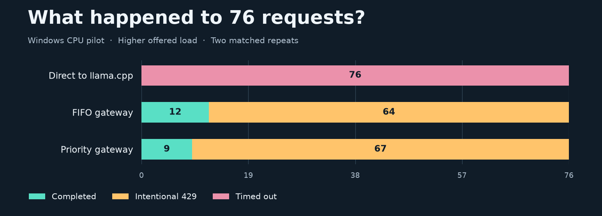
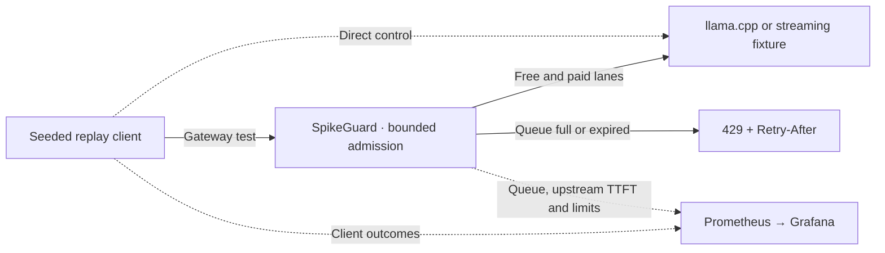

# SpikeGuard

**Deadline-aware admission control for streaming LLM workloads.**

When inference slots fill up, queued requests can spend their entire deadline waiting for a first token. SpikeGuard bounds that queue, rejects excess work with `429 Retry-After`, and can reserve admission capacity for paid traffic. It streams responses from a local llama.cpp server and measures the trade-off between fast rejections and successful completions.

[Run the demo](#run-the-demo) · [See the benchmark](#what-happened-under-overload) · [Read the runbook](docs/runbook.md)

## Run the demo

With Python 3.11 or newer, the demo runs the real gateway over HTTP against a two-slot streaming fixture. It needs only the Python dependencies. The replay takes about 15 seconds after setup.

**macOS and Linux**

```sh
python3 -m venv .venv
.venv/bin/python -m pip install -r requirements.txt
.venv/bin/python -m scripts.demo
```

**Windows PowerShell**

```powershell
python -m venv .venv
.\.venv\Scripts\python.exe -m pip install -r requirements.txt
.\.venv\Scripts\python.exe -m scripts.demo
```

The demo sends the same seeded requests directly to the fixture, through a FIFO gateway, and through a gateway with a paid reservation. The terminal shows completions, intentional sheds, errors, and p95 time to first content by tier. It saves phase summaries and request traces to `runs/demo.json`.

In one checked fixture run, FIFO completed **2 of 6** paid spike requests. The priority gateway completed **6 of 6** and shed **52 of 72** free requests, with zero unexpected errors. Add `--check` to check paid admission, recovery, `Retry-After`, and slot cleanup in your run.

## What happened under overload

In a matched llama.cpp pilot on Windows CPU, each path received **76 requests** at the higher tested rate across two repeats.



The gateways returned overload rejections within **0.30 seconds at p95** in each repeat. The priority gateway completed **2 of 4** paid requests versus zero through FIFO, at the cost of five fewer free completions. Both lanes shared the same model compute. Neither tested rate met the full latency and completion SLO. [Trial data and reproduction steps](benchmarks/README.md#windows-cpu-pilot-with-llamacpp)

## How it works



- **Admission.** The gateway caps active requests and queue time. Optional paid reservations protect upstream slots and waiting places. Requests remain FIFO within each lane.
- **Streaming.** One deadline covers body intake, admission, and upstream streaming. Disconnects release the upstream connection and slot. Replay counts completion only after assistant content and a complete SSE `[DONE]` event.
- **Adaptive concurrency.** The optional controller reduces the target when upstream first content is slow or fails. It recovers one slot at a time after healthy samples under saturation.
- **Measurement.** Open-loop replays offer arrivals on a schedule independently of completions. Capacity reports pair seeds, rotate target order, and evaluate throughput, p95 latency, and errors alongside completion by tier.

## Run a real model

On Apple Silicon, install native llama.cpp with `brew install llama.cpp` and launch `./scripts/serve.sh`. The default Qwen2.5 0.5B model is about **491 MB**, with two CPU threads and a 128 MiB prompt-cache limit. The default model replay sends five requests over 28 seconds. The runbook covers local GGUF files, CPU-only inference, the Windows pilot, and optional Docker Desktop monitoring. [Runbook](docs/runbook.md)

## Verify and explore

- Run `python -m unittest discover -s tests -v` using the Python from your virtual environment. [Cross-platform CI](https://github.com/aanyamehrotra/spikeguard/actions/workflows/test.yml) checks Linux, Windows, and ARM64 macOS.
- Inspect [gateway admission](gateway/admission.py), the [replay CLI](replay.py), and the [capacity sweep](capacity.py).
- Compare the [native and fixture benchmarks](benchmarks/README.md), including the original Apple Silicon overload runs.
