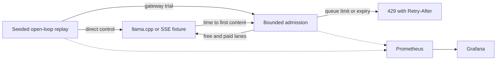

# SpikeGuard

SpikeGuard is a streaming gateway that protects paid LLM traffic when free traffic spikes. It caps upstream concurrency and queue time, rejects excess work with `429 Retry-After`, and leaves the model's token stream intact. The replay harness measures how those choices affect completion, first-token latency and recovery.

## Try it in under a minute

With Python 3.11 or newer, run these commands from the repository root. The demo starts a two-slot streaming fixture and the real gateway on temporary loopback ports.

```sh
python -m pip install -r requirements.txt
python -m scripts.demo --check
```

The demo sends the same baseline, spike and recovery traffic directly to the fixture, through a FIFO gateway and through a gateway with a reserved paid lane. It prints paid and free completion, sheds, errors and p95 time to first content for each path. The raw trace goes to `runs/demo.json`. The test suite also checks paid capacity and disconnect cleanup over HTTP.



Run `python -m unittest discover -s tests -v` for the full checks. See the [measured runs](benchmarks/README.md) for results, hardware and reproduction steps.

## What the benchmark showed

On a two-slot llama.cpp CPU run, the direct path timed out on all 76 requests at the higher offered rate. The priority gateway shed 67 and completed nine, including two of four paid requests. FIFO completed zero of the four paid requests. The reservation preserved paid admission while both lanes continued to share model compute. Neither tested rate met the full latency and completion SLO. [Windows CPU pilot](benchmarks/README.md#windows-cpu-pilot-with-llamacpp)

## Run the baseline on Apple Silicon

```sh
brew install llama.cpp
./scripts/serve.sh
```

The first launch downloads Qwen 2.5 3B Instruct Q4_K_M (about 2.1 GB). The launcher enables Metal offload, two parallel slots, continuous batching and the Prometheus metrics endpoint. Run inference natively because Docker Desktop's Linux containers cannot use the Mac's Metal GPU. The gateway, Prometheus and Grafana run in Docker. On a GPU host, vLLM can replace llama.cpp while retaining the streaming client and repeating the capacity sweep.

In another terminal with Python 3.11 or newer:

```sh
curl -fsS http://127.0.0.1:8080/health
curl -fsS http://127.0.0.1:8080/metrics
python3 -m venv .venv
.venv/bin/pip install -r requirements.txt
.venv/bin/python replay.py --output runs/direct.json
```

The default baseline, spike and recovery offer 0.5, 8 and 0.5 requests per second over 30, 30 and 45 seconds. Tune `--rates` so baseline is healthy and the spike overloads your Mac. Requests arrive on schedule independently of previous completions. Keep rates, durations, seed and timeout fixed between direct and gateway runs. Warm the model before measurement and record the Mac hardware, llama.cpp version, model quantization and slot count.

The JSON records per-request dispatch lag, status, latency and outcome. TTFT starts at client dispatch and ends at the first nonempty assistant content. Completion requires a complete SSE `[DONE]` event. Phase summaries group requests by scheduled arrival and report completed-stream p95, intentional sheds, errors, and tail latency for dispatch, completion and shedding. Completed requests per offered second includes completions after the phase ended. Read completion fraction alongside p95, especially when requests time out.

## Replay through the gateway

Keep the native model running with two parallel slots. From the repo:

```sh
docker compose up -d --build
curl -fsS http://127.0.0.1:8081/ready
.venv/bin/python replay.py --url http://127.0.0.1:8081 --metrics-port 9109 --output runs/gateway.json
```

The gateway forwards the chat response as it arrives. Each request has a deadline covering its body, queue wait and upstream response. A full queue or an expired queue wait returns `429` with `Retry-After: 1` and the admission reason in `X-SpikeGuard-Shed`. Replay counts upstream rate limits as HTTP errors. A request deadline before upstream headers returns `504`. After headers, a deadline can end the stream before its completion marker. Replay records an incomplete stream or a timeout, depending on which deadline takes effect first. A client disconnect removes its queue entry or closes its upstream stream before handing off the slot.

| Environment variable | Default | Controls |
| --- | ---: | --- |
| `SPIKEGUARD_CONCURRENCY` | 2 | Maximum simultaneous upstream requests. Match llama.cpp's slot count. |
| `SPIKEGUARD_QUEUE_LIMIT` | 2 | Number of waiting requests. Set to zero to reject immediately when all slots are busy. |
| `SPIKEGUARD_QUEUE_WAIT_S` | 0.25 | Maximum admission wait in seconds. |
| `SPIKEGUARD_DEADLINE_S` | 25 | End-to-end request budget in seconds. |
| `SPIKEGUARD_PAID_SLOTS` | 0 | Upstream slots reserved for paid requests. Leave at least one free slot. |
| `SPIKEGUARD_PAID_QUEUE_SLOTS` | 0 | Waiting places reserved for paid requests, within the total queue limit. |
| `SPIKEGUARD_ADAPTIVE` | 0 | Set to `1` to adjust the concurrency limit during a run. |
| `SPIKEGUARD_ADAPTIVE_MIN` | paid slots + 1 | Lowest adaptive concurrency target. |
| `SPIKEGUARD_ADAPTIVE_TARGET_S` | 1.5 | Upstream time-to-first-content threshold in seconds. |
| `SPIKEGUARD_ADAPTIVE_RECOVERY_SAMPLES` | 8 | Fast, saturated samples needed to raise the limit by one. |

Run one gateway worker so all requests share the same in-process limit. `/health` checks the gateway process, `/ready` checks the upstream model, and `/metrics` reports active requests, queue depth, and rejections by reason. For a matched run, keep the replay seed, traffic schedule, model settings and client deadline fixed, and let the model return to idle between runs.

## Isolate paid traffic during a spike

```sh
SPIKEGUARD_PAID_SLOTS=1 SPIKEGUARD_PAID_QUEUE_SLOTS=1 docker compose up -d --build
.venv/bin/python replay.py --url http://127.0.0.1:8081 --metrics-port 9109 \
  --rates 0.125 2 0.125 --paid-rates 0.125 0.125 0.125 \
  --durations 60 60 60 --timeout 25 --output runs/priority.json
```

`--rates` schedules free traffic and `--paid-rates` adds an independent, seeded paid stream. The CLI adds `X-SpikeGuard-Tier: paid` to that stream. The gateway uses the header for admission in this loopback benchmark and strips it before forwarding. For an authenticated deployment, tier classification must come from a trusted identity layer.

Paid requests may use spare shared capacity and take priority when a slot opens. The gateway admits requests FIFO within each lane. Free traffic cannot borrow the reserved upstream and queue places. With both reservations at zero, the gateway uses a single FIFO lane. Read `tier_summary` in the replay JSON to compare each tier's completion, shed fraction, error fraction and p95 TTFT by arrival phase.

## Adapt concurrency during overload

Start llama.cpp with `SLOTS=4 ./scripts/serve.sh`. In another terminal, run the gateway with a matching maximum.

```sh
SPIKEGUARD_CONCURRENCY=4 SPIKEGUARD_ADAPTIVE=1 \
  SPIKEGUARD_PAID_SLOTS=1 SPIKEGUARD_PAID_QUEUE_SLOTS=1 docker compose up -d --build
```

Leave room between the minimum and maximum for the limit to move. With a two-slot model and one reserved paid slot, the minimum and maximum both equal two.

The controller starts at the configured maximum. It halves the limit down to the minimum when upstream first content takes at least the configured threshold, a request expires before first content, or an upstream failure prevents content. Queue wait, admission 429s, and downstream disconnects are excluded from this signal. At a reduced limit, a streak of fast requests admitted at saturation raises the limit by one. In-flight work drains after a reduction and the paid reservation remains available during the transition. The dashboard plots the target limit and actual usage separately.

## Measure steady-state capacity

Start the model and gateway as above. The default sweep uses short pilot windows. Use a low rate first and raise it until a tested point fails one of the SLO checks. The following longer run offers at least 100 measured requests at the lowest tested rate in each repeat.

```sh
.venv/bin/python capacity.py --rates 0.05 0.1 0.2 \
  --warmup 60 --duration 2000 --repeats 2 --min-samples 100 \
  --environment 'Record hardware, llama.cpp version, model, quantization and gateway settings' \
  --output runs/native-capacity.json
```

The default targets are direct llama.cpp and the gateway. Use repeated `--target NAME=URL` flags to compare other loopback configurations. `--paid-rate` adds constant paid traffic to every tested point. Match the model settings and restart the gateway when changing configurations so each sweep starts from the same controller state. Use `--include-requests` to retain the request-level traces, including warm-up.

The sweep excludes warm-up by scheduled arrival and waits for in-flight requests before moving to the next trial. It rotates target order and uses the same ticket seed across targets within a repeat. The report includes a workload fingerprint, the execution order, actual offered rate and p95 dispatch lag so results can be audited. A test point passes when p95 TTFT is below 2 seconds, unexpected errors are below 1% of offered requests, and completion is at least 99%. Each active tier and the aggregate must pass in every repeat. A rate with too few requests is reported as insufficiently sampled and cannot qualify. The result is the highest **tested** passing rate under the recorded setup. See the [benchmark results and fixture](benchmarks/README.md).

## Watch a replay in Grafana

With llama.cpp running on port 8080, start Docker Desktop and run these commands from the repo:

```sh
docker compose up -d
.venv/bin/python replay.py --metrics-port 9109 --output runs/direct.json
```

Open [SpikeGuard · Replay overview](http://localhost:3000/d/spikeguard-overview) in Grafana. On first login use Grafana's default `admin` / `admin` and set a new password. The [Prometheus targets page](http://localhost:9090/targets) shows whether scrapes are working. The `replay` target is available only while a replay with metrics enabled is running. Both services are published on loopback. Docker Desktop reaches the native endpoints through `host.docker.internal`.

Start with completion and p95 time to first content by tier. The gateway timing panel separates admission wait from upstream first content. Compare active slots with the adaptive limit to see work drain after a reduction. Dashboard replay metrics use rolling 12-second windows, and late outcomes keep their original arrival phase. The dashboard estimates p95 from histogram buckets. Its live fractions use terminal outcomes. Use the final JSON for exact counts and offered-request denominators.

Metrics mode leaves five seconds before the first request and after the last outcome so Prometheus can collect the initial and final counters. For a fresh run, zoom Grafana to the minutes around the replay. `docker compose down` stops monitoring and preserves its local volumes.

See [AGENTS.md](AGENTS.md) for the draft SLO and test scenarios. The [measured direct and gateway runs](benchmarks/README.md) show the trade-off between queueing and explicit rejection. Apple Silicon capacity depends on the hardware, model and slot configuration.

[llama.cpp server documentation](https://github.com/ggml-org/llama.cpp/blob/master/tools/server/README.md) · [Qwen model card](https://huggingface.co/Qwen/Qwen2.5-3B-Instruct-GGUF) · [Docker Desktop host connectivity](https://docs.docker.com/desktop/features/networking/networking-how-tos/)
